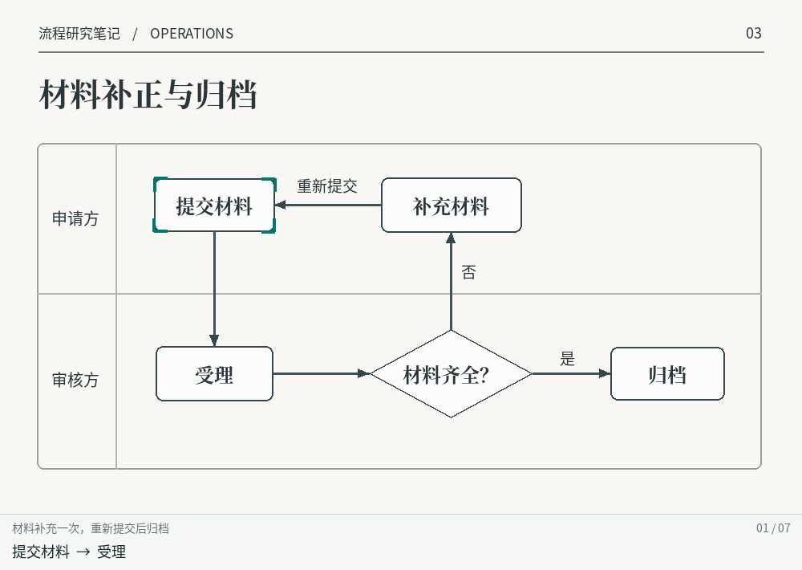

# Trace Diagram · 流程图路径动画

Give a vision-capable agent a flowchart and a scenario. Get an animation that follows the original arrows, a numbered review sheet, and a route you can edit.

上传一张流程图，说「演示缺材料被退回，补一次后通过」。画面保留原排版，小圆点沿实际连线行进。这个例子两次经过同一个判断，第一次退回，第二次归档。



[观看 MP4](examples/resubmission/resubmit_once.mp4) · [查看原图](examples/resubmission/source.png) · [查看编号预览](examples/resubmission/resubmit_once.png) · [查看这条路线](examples/resubmission/route.json)

## Try it in two minutes

**Already have a diagram? Keep it.** Trace Diagram adds a walkthrough to the screenshot instead of redrawing the diagram. To review a route, check the numbered arrows against the source, then edit the route JSON and replay it.

- **Watch first (no install):** Open the [retry example](examples/resubmission/resubmit_once.mp4). The same decision is reached twice: first “No” loops back to resubmit; then “Yes” goes to the archive. Compare the [original](examples/resubmission/source.png), [numbered review](examples/resubmission/resubmit_once.png), and [editable route](examples/resubmission/route.json).
- **Reproduce it locally (no model or key):** From a checkout with Python 3.10+, run the commands below. Replace `python` with `python3` if that is how Python is installed.

```sh
python -m pip install -r requirements.txt
python skills/trace-diagram/scripts/trace.py review examples/resubmission/source.png examples/resubmission/route.json --scene resubmit_once --out build/review.png
python skills/trace-diagram/scripts/trace.py render examples/resubmission/source.png examples/resubmission/route.json --scene resubmit_once --out build/resubmit.gif
```

- **Try your own:** Copy [the skill](skills/trace-diagram) into `.agents/skills/` and give a vision-capable agent a diagram plus one concrete scenario. The agent proposes the route; Python checks and renders it. If a path includes an edge marked uncertain, the renderer stops rather than choosing a direction for you. The numbered preview is for checking interpretation, not proof the model always read the diagram correctly.

Today this starts from **a diagram and a scenario**, not a whole paper or article. The local replay above uses a supplied route and does not test visual recognition. Your own image is read in whichever agent environment you choose.

## 在 Codex 中使用

需要支持图像输入、能读写文件和执行 Python 的 Agent。将本项目的 [skills/trace-diagram](skills/trace-diagram) 目录复制到你的 Codex 项目的 `.agents/skills/` 下，保留目录名。安装 Python 3.10 或以上版本，然后在仓库根目录执行：

```sh
python -m pip install -r requirements.txt
```

向 Agent 上传一张图并说：

> 用 $trace-diagram 演示材料不齐、退回补正一次后归档。给我编号预览和 GIF。如果哪条线的方向看不清，请把它标出来。

Agent 读取原图、识别节点和有向连线，按情景写出路线。Python 程序校验连通性、端点位置和待确认项，并绘制动画。纠正时可直接说「E3 的终点应是 N4」；其余编号继续沿用。渲染在本地执行，不需要额外的模型 API 密钥。图片的理解发生在你选用的 Agent 环境中。

## 直接重放示例

仓库已包含识图结果。下列命令只需要 Python 与 Pillow，不会调用模型。在仓库根目录运行：

```sh
python skills/trace-diagram/scripts/trace.py review examples/unit-check/source.png examples/unit-check/route.json --scene inconsistent --out build/review.png
python skills/trace-diagram/scripts/trace.py render examples/unit-check/source.png examples/unit-check/route.json --scene inconsistent --out build/unit-check.gif
```

将最后一个扩展名改为 `.mp4` 可输出 H.264 视频，需在 PATH 中安装含 libx264 的 FFmpeg。要演示同一图的另一个结果，把情景 ID 换成 `consistent`。

| 测试原图 | 可播放情景 |
| --- | --- |
| [样品签收](examples/sample-intake/source.png) | [签收 → 登记 → 入柜](examples/sample-intake/intake.gif) |
| [单位校核](examples/unit-check/source.png) | [一致，确认入库](examples/unit-check/consistent.gif) · [不一致，标记待核](examples/unit-check/inconsistent.gif) |
| [跨泳道补正](examples/resubmission/source.png) | [退回一次再归档](examples/resubmission/resubmit_once.gif) |
| [交叉线与无箭头连线](examples/crossed-lines/source.png) | [订单 → 校验库存](examples/crossed-lines/order_next.gif) · [查看橙色待核边 E3](examples/crossed-lines/order_next.png) |

## 自己的图

```sh
python skills/trace-diagram/scripts/trace.py prepare input.jpg --out build/sheet.png --grid build/grid.png
```

把原图和带网格的辅助图交给 Skill；它按[路线格式](skills/trace-diagram/references/route.md)生成 JSON。节点、连线和场景有稳定编号。同一连线可以重复走；同一张图可存多种情景。无箭头或方向不明的边可进入预览，播放经过该边的情景时会提示具体编号并停止。校验程序可以发现断开的路线、倒置的坐标和越界点；能否正确解释业务条件，仍需要对照原图检查。

支持 PNG、JPEG 和 WebP。PDF 可以用 Poppler 的 pdftoppm 搭配 `--page 2` 选页；本地独立 SVG 可用 Inkscape 光栅化。draw.io 请导出 PNG 或 SVG，并可让 Agent 参考源文件。预览和视频字幕需要支持对应语言的字体；中文缺字时在 review、render 命令后加 `--font 字体文件路径`。

## 验证范围

四张公开示例均为本项目制作的合成图。独立识图时仅提供图片和场景说明，随后将结果与预期业务顺序比对。五个情景已实际生成 GIF，含一次跨泳道回退的示例也已生成 MP4。复杂论文图、密集扫描件和手绘图的准确率尚待独立评估。

```sh
python -m unittest discover -s tests -v
```

MIT License.
